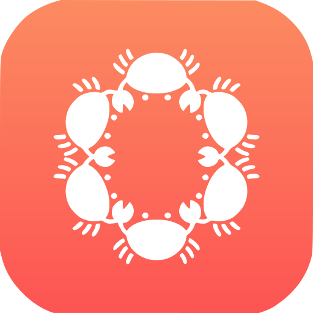
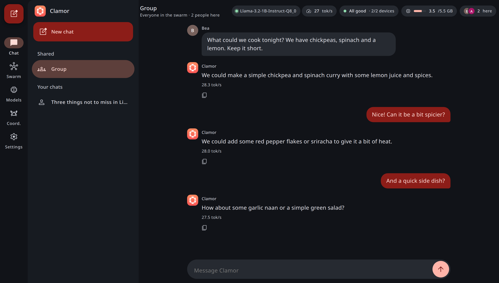
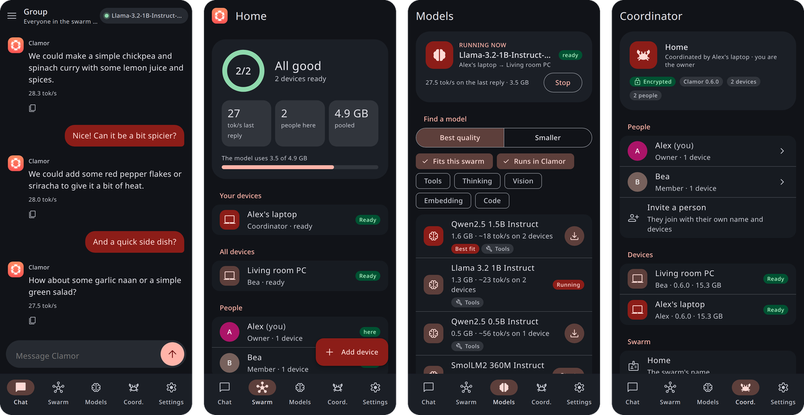
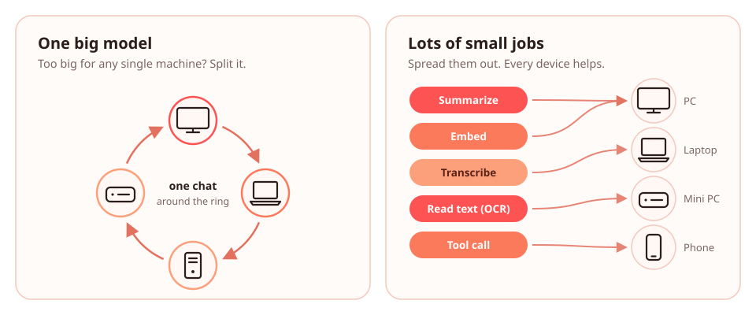
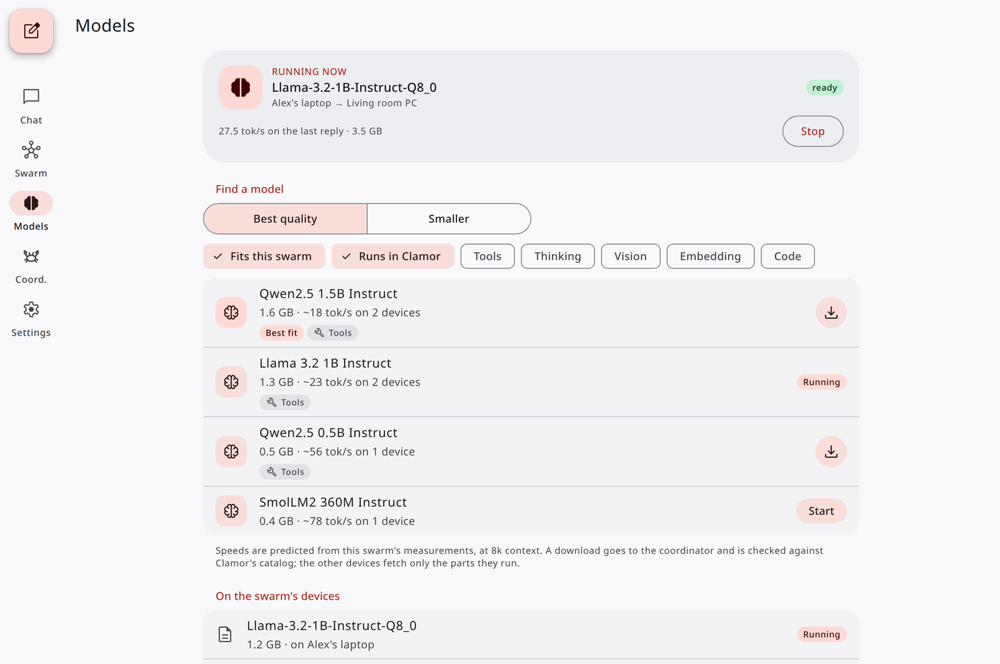

<p align="center">
  
</p>

<h1 align="center">Clamor</h1>

<p align="center">
  <strong>Pool the idle computers on your network to run AI none of them could run alone.</strong>
</p>

<p align="center">
  <a href="https://github.com/amruthwo/Clamor/actions/workflows/ci.yml"></a>
  <a href="LICENSE"></a>
</p>

<p align="center">
  
</p>

> [!NOTE]
> Clamor is young: it works, and it is changing quickly. Expect rough edges, and see
> [What works today](#what-works-today) for what has been tested where.

## What is Clamor?

Most homes and offices have computers sitting idle: an old gaming PC, a laptop on the shelf, a mini PC, a phone on
its charger. On its own, none of them has enough memory to run a capable AI model. Together, they might.

Clamor lets those machines team up. Start it on one computer, join the others with one command, and they work like
one bigger machine. Everything stays on your own network: no cloud, no accounts, and your data never leaves the room.

The icon is the idea in a picture: each crab is a computer, and they hold claws in a ring because that is how Clamor
passes work between them.

## What you can do

- **Chat with a model none of your devices could run alone**, in a group chat everyone in the swarm shares, or in
  your own chats that only you can open from any of your devices. Replies appear as they are written.
- **Keep a chat truly private**: in a [private chat](docs/private-chats.md) your own device runs the first and last
  part of the model, so your words never leave it, not even to the computer coordinating the swarm.
- **Find a model that fits**: Clamor measures your devices and shows which models it can run, how fast, and over
  how many devices. Filter by what a model can do (tools, thinking, vision, code), download it with one click, and
  start it. Downloads are checked against Clamor's catalog. See [models](docs/models.md).
- **Add devices in seconds**: scan a QR code with the phone app, type a six-digit code, or ask to join and let an
  admin approve it. Phones help too, while they are charging.
- **Stay in charge of each device**: how much memory and processor Clamor may use, whether it works on battery,
  and whether it steps aside while you use the device. See [device settings](docs/device-settings.md).
- **Connect your apps**: Clamor speaks OpenAI's API, so coding assistants, chat apps and scripts can use your
  swarm's model with an API key. See [connecting apps](docs/api.md).
- **Share it with the household**: people have their own names and devices, with owner, admin and member roles.
  See [people](docs/people.md).

<p align="center">
  
</p>

## How it works

### One big model, split across machines

An AI language model is a stack of layers. Clamor cuts that stack into pieces sized to each machine's memory, so
every computer holds only its share. To produce each word, the work travels once around the ring: each machine runs
its layers and hands the result to the next, and the last one sends the new word back to the start.

<picture>
  <source media="(prefers-color-scheme: dark)" srcset="assets/diagram-split-dark.svg">
  
</picture>

An honest caveat: pooling makes a big model **fit**; it doesn't make it **fast**. Every word has to visit every
machine, so a model split across a home network runs at a few words per second, limited by the slowest computer and
the network between them. That's the price of running something no single machine you own could run at all.

### Lots of small jobs, spread out (planned)

The other half of Clamor, still to come, is breadth. AI assistants and agents create streams of small, separate
jobs: summarize this, transcribe that, read the text in this image. Those don't need one big model; they need many
hands. Clamor will hand each job to a device that suits it, and there every device helps, even a phone.

<picture>
  <source media="(prefers-color-scheme: dark)" srcset="assets/diagram-lanes-dark.svg">
  
</picture>

### It measures before it plans

Before you pick a model, Clamor runs a quick **muster**: it measures each device's processing speed, memory and
memory bandwidth, and the speed of the network between them. From that it tells you which models will fit, how fast
each should run, and what is holding things back: a slow machine, or the network.

Devices can leave whenever their owner needs them: a device can be paused or removed from the app, and a device
that drops off can rejoin later without benchmarking again.

## What works today

| | |
|---|---|
| **Swarms** | Start one on any computer; devices join with a QR code, a one-time code, the passphrase (never sent over the network) or by asking; they find the swarm on the local network and rejoin by themselves |
| **Models** | Llama 3.x, Qwen2.5, Qwen3 and SmolLM2 (and others built the same way), split across devices; one device needs the file, the others fetch their share. Checked against a reference implementation. A catalog of 24 models with predicted speeds for your swarm and verified downloads |
| **Chat** | Group, personal and private chats, streaming replies with Stop, each person's preferences |
| **Apps** | Desktop app (Linux: Flatpak, .deb, .rpm, AppImage; macOS; Windows) and an Android app, the same Material 3 design on every screen size; they update themselves when you agree |
| **Security** | Encrypted connections between devices, device keys, people with roles, sign-in for browsers |
| **Command line** | `clamor-node` for servers and scripts (Linux, macOS, Windows, Android in Termux), updates itself (signed) |

CI runs the tests on Linux (x86_64 and arm64), Windows and macOS, and builds every installer and the Android app.
Tried by hand: Linux on an Apple M1 (Fedora Asahi, including GPU inference with Vulkan) and Android on a Galaxy S24
Ultra. The macOS and Windows apps are built by CI but not yet tried on real machines. CUDA builds are
compile-checked only.

**Coming next:** tool calling (for coding agents) with an
optional online mode and MCP, model handover when a device leaves, using your swarm away from home, and more model
families (Gemma 3, vision and embedding models).

## Try it

1. **Install the app** on the computer that will coordinate the swarm, from the
   [latest release](https://github.com/amruthwo/Clamor/releases/latest) (see the
   [desktop app guide](docs/desktop-app.md); on Android, the [Android guide](docs/android.md)).
2. Choose **Start a swarm**. Clamor measures the computer, which takes about a minute.
3. On **Models → Find a model**, pick one marked **Best fit**, press **Download**, then **Start**.
4. Chat. To add more devices, press **Add device** on the **Swarm** tab: scan the QR code with the phone app, or
   type the code on the new device.

### From the command line

You need [Rust](https://rustup.rs), CMake and a C++ compiler to build from source (or take `clamor-node` from a
release). Then:

```bash
git clone https://github.com/amruthwo/Clamor.git && cd Clamor
cargo build --release
```

On the first computer, start a swarm. It makes up a passphrase of five words and prints the command to join:

```bash
./target/release/clamor-node coordinator --swarm home
#   swarm 'home' passphrase: harbor-velvet-crab-lantern-ninety
#   add a device: clamor-node join 192.168.1.20 --passphrase harbor-velvet-crab-lantern-ninety
```

On each other computer, run that command once (or just `clamor-node join --passphrase <words>`: it finds the
swarm on the network). After that, `clamor-node join` on its own is enough: the device remembers the swarm and
is recognised by its own key. See the [joining guide](docs/joining.md).

Then open `http://<first-computer-ip>:7421/` in any browser on your network, phone included.

#### Models and chat through the API

Models can be downloaded from the dashboard (**Models → Find a model**), or put the model file in a `models` folder next to where you run `clamor-node`, on **any one** of your machines.
The others fetch just the layers they need from it, keep them in their cache, and reuse them next time. A
small model to start with is
[SmolLM2 360M Instruct](https://huggingface.co/HuggingFaceTB/SmolLM2-360M-Instruct-GGUF) (386 MB, Apache-2.0):

```bash
mkdir -p models && curl -L -o models/smollm2-360m-instruct-q8_0.gguf \
  https://huggingface.co/HuggingFaceTB/SmolLM2-360M-Instruct-GGUF/resolve/main/smollm2-360m-instruct-q8_0.gguf
```

Split it across two machines (use the names shown in the dashboard; leave out `stages` to let the planner choose):

```bash
curl -X POST http://<first-computer-ip>:7421/api/pipeline -H 'content-type: application/json' \
  -d '{"model": "smollm2-360m-instruct-q8_0.gguf", "stages": [{"node": "laptop", "layers": [0, 16]}, {"node": "desktop", "layers": [16, 32]}]}'
```

Once `GET /api/pipeline` says `"ready": true`, ask it something:

```bash
curl -X POST http://<first-computer-ip>:7421/api/chat -H 'content-type: application/json' \
  -d '{"messages": [{"role": "user", "content": "What is the capital of France?"}]}'
```


> [!WARNING]
> The passphrase is never sent over the network, only approved devices can join or download models, the
> connections between devices are encrypted, and the dashboard needs a sign-in with owner, admin and member roles
> (see [people and signing in](docs/people.md)). The plain browser dashboard on port 7421 is not encrypted; use the
> app, or `https://<coordinator>:7424/`.

<p align="center">
  
</p>

## For developers

Clamor is a Rust workspace:

| Crate | What it does |
|---|---|
| `clamor-proto` | Control messages between the coordinator and devices (JSON over TCP, port 7420) |
| `clamor-muster` | Device probes, benchmarks, network tests, and the planner that splits models; also a CLI |
| `clamor-node` | The coordinator, the member that joins, the dashboard (port 7421; its page is `src/portal.html`), the model catalog and downloads |
| `clamor-transport` | The binary ring transport between pipeline stages: flow control, plan epochs, cancel |
| `clamor-engine-ggml` | Inference on [ggml](https://github.com/ggml-org/ggml) (vendored): devices, GGUF loading, layer-range Llama stages |

Useful commands:

```bash
cargo test --workspace --release                      # everything (engine tests need: pip install numpy gguf)
cargo run -p clamor-engine-ggml --release --example devices                     # list compute devices
cargo run -p clamor-engine-ggml --release --features vulkan --example devices   # GPU backends are cargo features
cargo run --release -p clamor-transport --bin transport-bench -- --stages 3 --concurrency 1,2,4,8

# Run the muster by hand, no swarm needed
./target/release/clamor-muster probe --out a.json                         # on each machine
./target/release/clamor-muster serve                                      # on the coordinator
./target/release/clamor-muster probe --coordinator <ip>:7422 --out b.json # measures the link too
./target/release/clamor-muster plan a.json b.json --quant q4 --ctx 8192
```

Always benchmark with `--release`: debug builds are far too slow to plan with.

GPU backends need their SDKs: Vulkan builds need the Vulkan headers and loader plus the `glslc` shader compiler
(Fedora: `vulkan-loader-devel glslc spirv-headers-devel`; Debian/Ubuntu: `libvulkan-dev glslc spirv-headers`).

- [`docs/`](docs): user guides
- [`apps/desktop`](apps/desktop): the desktop and Android app (Tauri)
- [`design/prototype`](design/prototype): the clickable Material 3 prototype the interface was built from
- [`assets/`](assets): icon, diagrams, screenshots and social preview; diagrams are generated by `assets/src/make_graphics.py`
- `tools/`: reference implementations for tests, and the generators for the icon set (`gen-icons.py`) and the
  model catalog (`build-catalog.py`)

## License

Clamor is free software, licensed under the [GNU General Public License v3.0 or later](LICENSE). You can use, study,
share and change it. If you distribute Clamor or a modified version, you must share its source under the same terms.

Clamor includes [ggml](https://github.com/ggml-org/ggml) in `vendor/ggml`, which is MIT-licensed
(see [`vendor/ggml/LICENSE`](vendor/ggml/LICENSE)). Passphrases are made from the
[EFF large wordlist](https://www.eff.org/dice) (`crates/clamor-node/data/eff_large_wordlist.txt`) by the Electronic
Frontier Foundation, used under [CC BY 3.0 US](https://creativecommons.org/licenses/by/3.0/us/). Icons are
[Material Symbols](https://fonts.google.com/icons) by Google, under the
[Apache License 2.0](https://www.apache.org/licenses/LICENSE-2.0).
