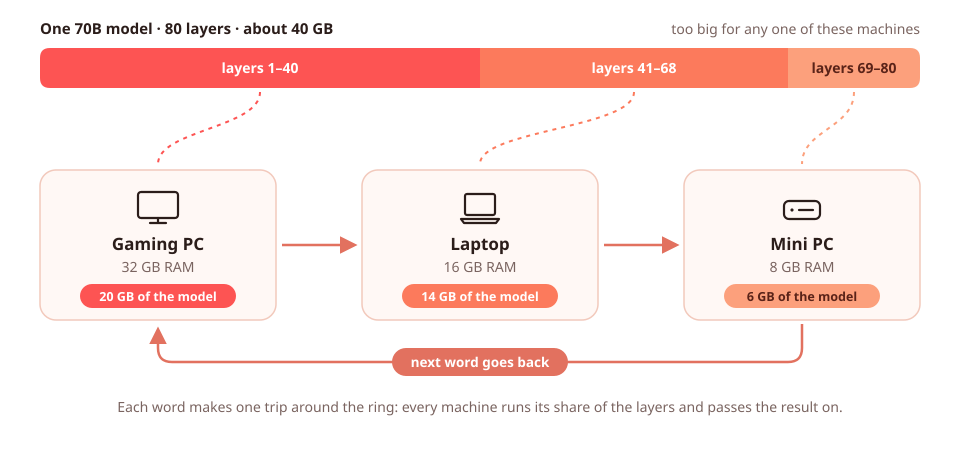

<p align="center">
  
</p>

<h1 align="center">Clamor</h1>

<p align="center">
  <strong>Pool the idle computers on your network to run AI none of them could run alone.</strong>
</p>

<p align="center">
  <a href="https://github.com/amruthwo/Clamor/actions/workflows/ci.yml"></a>
  <a href="LICENSE"></a>
</p>

> [!NOTE]
> Clamor is early and experimental. Devices can already join a swarm, measure themselves, and plan how to share a
> model. Running a real model across machines is being built right now (see [What works today](#what-works-today)).

## What is Clamor?

Most homes and offices have computers sitting idle: an old gaming PC, a laptop on the shelf, a mini PC, a phone on
its charger. On its own, none of them has enough memory to run a capable AI model. Together, they might.

Clamor lets those machines team up. Start it on one computer, join the others with one command, and they work like
one bigger machine. Everything stays on your own network: no cloud, no accounts, and your data never leaves the room.

The icon is the idea in a picture: each crab is a computer, and they hold claws in a ring because that is how Clamor
passes work between them.

## How it works

### One big model, split across machines

An AI language model is a stack of layers. Clamor cuts that stack into pieces sized to each machine's memory, so
every computer holds only its share. To produce each word, the work travels once around the ring: each machine runs
its layers and hands the result to the next, and the last one sends the new word back to the start.

<picture>
  <source media="(prefers-color-scheme: dark)" srcset="assets/diagram-split-dark.svg">
  
</picture>

An honest caveat: pooling makes a big model **fit**; it doesn't make it **fast**. Every word has to visit every
machine, so a model split across a home network runs at a few words per second, limited by the slowest computer and
the network between them. That's the price of running something no single machine you own could run at all.

### Lots of small jobs, spread out

The other half of Clamor is breadth. AI assistants and agents create streams of small, separate jobs: summarize
this, transcribe that, read the text in this image. Those don't need one big model; they need many hands. Clamor
hands each job to a device that suits it, and here every device helps, even a phone.

<picture>
  <source media="(prefers-color-scheme: dark)" srcset="assets/diagram-lanes-dark.svg">
  
</picture>

### It measures before it plans

Before you pick a model, Clamor runs a quick **muster**: it measures each device's processing speed, memory and
memory bandwidth, and the speed of the network between them. From that it tells you which models will fit, how fast
each should run, and what is holding things back: a slow machine, or the network.

Devices can leave whenever their owner needs them: one click in the dashboard drains a device, and a device that
drops off can rejoin later without benchmarking again.

## What works today

| | |
|---|---|
| **Works** | Starting a swarm, joining with a token, automatic benchmarks, a web dashboard showing devices and which models fit |
| **Works** | The ring connection that carries work between machines (tested with a stand-in engine) |
| **Works** | Running a slice of a real Llama-style model's layers, checked against a reference implementation |
| **In progress** | Connecting the model engine to the ring, a tokenizer, compressed (quantized) models, a real model on two machines |
| **Planned** | Chat in the dashboard, an OpenAI-compatible API for agent tools, a phone app, automatic discovery, encryption between devices |

CI runs the tests on Linux (x86_64 and arm64), Windows and macOS. The Vulkan, CUDA and Android builds are
compile-checked only. GPU inference has been tested by hand with Vulkan on an Apple M1 running Asahi Linux.

## Try it

You need [Rust](https://rustup.rs), CMake and a C++ compiler. Then:

```bash
git clone https://github.com/amruthwo/Clamor.git && cd Clamor
cargo build --release
```

On the first computer, start a swarm (pick your own secret):

```bash
./target/release/clamor-node coordinator --swarm home --token SECRET
```

On each other computer, join it:

```bash
./target/release/clamor-node join <first-computer-ip> --token SECRET
```

Then open `http://<first-computer-ip>:7421/` in any browser on your network, phone included, to see the swarm
measure itself and suggest models.

> [!WARNING]
> For now, devices join with a shared token over unencrypted connections. Only run Clamor on a network you trust.

## For developers

Clamor is a Rust workspace:

| Crate | What it does |
|---|---|
| `clamor-proto` | Control messages between the coordinator and devices (JSON over TCP, port 7420) |
| `clamor-muster` | Device probes, benchmarks, network tests, and the planner that splits models; also a CLI |
| `clamor-node` | The coordinator, the member that joins, and the web portal (port 7421) |
| `clamor-transport` | The binary ring transport between pipeline stages: flow control, plan epochs, cancel |
| `clamor-engine-ggml` | Inference on [ggml](https://github.com/ggml-org/ggml) (vendored): devices, GGUF loading, layer-range Llama stages |

Useful commands:

```bash
cargo test --workspace --release                      # everything (engine tests need: pip install numpy gguf)
cargo run -p clamor-engine-ggml --release --example devices                     # list compute devices
cargo run -p clamor-engine-ggml --release --features vulkan --example devices   # GPU backends are cargo features
cargo run --release -p clamor-transport --bin transport-bench -- --stages 3 --concurrency 1,2,4,8

# Run the muster by hand, no swarm needed
./target/release/clamor-muster probe --out a.json                         # on each machine
./target/release/clamor-muster serve                                      # on the coordinator
./target/release/clamor-muster probe --coordinator <ip>:7422 --out b.json # measures the link too
./target/release/clamor-muster plan a.json b.json --quant q4 --ctx 8192
```

Always benchmark with `--release`: debug builds are far too slow to plan with.

GPU backends need their SDKs: Vulkan builds need the Vulkan headers and loader plus the `glslc` shader compiler
(Fedora: `vulkan-loader-devel glslc spirv-headers-devel`; Debian/Ubuntu: `libvulkan-dev glslc spirv-headers`).

- [`assets/`](assets): icon, diagrams and social preview; diagrams are generated by `assets/src/make_graphics.py`

## License

Clamor is free software, licensed under the [GNU General Public License v3.0 or later](LICENSE). You can use, study,
share and change it. If you distribute Clamor or a modified version, you must share its source under the same terms.

Clamor includes [ggml](https://github.com/ggml-org/ggml) in `vendor/ggml`, which is MIT-licensed
(see [`vendor/ggml/LICENSE`](vendor/ggml/LICENSE)).
